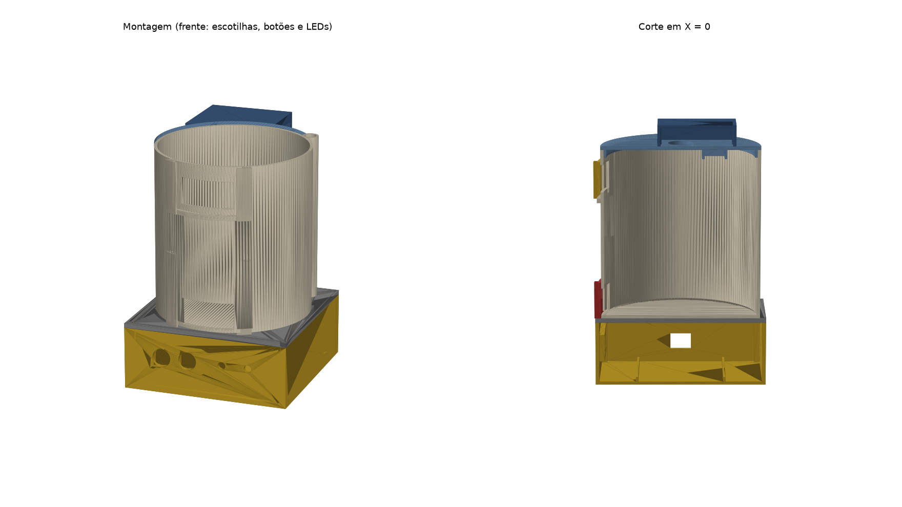

# Silo em 3D

Peças do silo de grãos para impressora com volume de **120 × 120 × 120 mm**. As medidas das peças eletrônicas
estão em [`docs/arquitetura.md`](../../docs/arquitetura.md) §3; as do silo, no início de `gerar_stl.py`.



## Peças

Os STLs em `stl/` já estão na orientação de impressão: é só abrir no fatiador, sem girar.

| Arquivo | Qtd | Medida (mm) | Observação de impressão |
|---|---|---|---|
| `0_peca_teste.stl` | 1 | 102 × 32 × 6 | **Imprimir primeiro** (~15 min) e testar os encaixes (abaixo) |
| `1_base.stl` | 1 | 112 × 112 × 45 | Caixa da eletrônica. Aberta em cima, sem suporte |
| `2_tampa_base.stl` | 1 | 112 × 112 × 7 | Abas para cima |
| `3_corpo.stl` | 1 | 104 × 106 × 112 | Piso na mesa. Sem suporte: as aberturas das escotilhas são pontes de 36 mm |
| `4_tampa_silo.stl` | 1 | 104 × 104 × 8 | Topo na mesa, encaixe e bolso do DHT11 para cima |
| `5_capa_sensor.stl` | 1 | 57 × 52 × 17 | Topo na mesa, pinos para cima |
| `6_escotilha.stl` | **2** | 47 × 9 × 24 | Em pé, como sai do arquivo. Usar brim: a peça é fina |

**Fatiador:** PLA, camada 0,2 mm, 3 perímetros, 15–20% de preenchimento, **sem suporte**. A base e a tampa da base
ocupam 112 mm da mesa de 120: **desligar saia (skirt) e brim** nessas duas, senão não cabem.

## Peça de teste

Antes das peças grandes, conferir com os componentes reais:

| Furo | Esperado | Se não servir |
|---|---|---|
| 2 × Ø16,5 (centros a 26) | Transdutores do HC-SR04 entram juntos, sem forçar | Ajustar `HC_FURO_D` / `HC_CENTROS` |
| Furo Ø12,5 + bolso quadrado | Capa do botão passa pelo furo; o corpo 12 × 12 assenta no bolso | Ajustar `BOTAO_FURO_D` / `BOTAO_BOLSO` |
| LED Ø5,2 e Ø5,5 | No de 5,2 o LED entra justo e a aba segura | Se não entrar, usar 5,5 em `LED_FURO_D` e colar |
| Bolso retangular | DHT11 encaixa | Ajustar `DHT_BOLSO` |

Depois de mudar um valor, gerar os STLs de novo (abaixo).

## Montagem

```
        capa do sensor   ← HC-SR04 por baixo dela, transdutores atravessando a tampa
        tampa do silo    ← DHT11 no bolso de baixo, virado para dentro do silo
   ┌──  corpo do silo    ← escotilha de entrada (em cima) e de saída (embaixo), na frente
   │    conduíte         ← tubo atrás, à direita: fios do HC-SR04 e do DHT11 descem por ele
        tampa da base    ← abas centralizam o corpo; furo do conduíte
        base             ← protoboard + ESP32; botões e LEDs no painel da frente; USB na lateral esquerda
```

1. **Base:** encaixar a protoboard de 400 pontos nas guias, encostada na parede do USB, com o ESP32 na ponta desse
   lado. Conferir se o cabo micro-USB entra pela abertura.
2. **Painel da frente**, da esquerda para a direita: botão **amarelo (entrada)**, botão **vermelho (saída)**, LED de
   **alerta** e LED de **ventilação**. Botões por dentro, com o corpo no bolso quadrado; LEDs por dentro, com a aba
   encostada na parede. Firmar com cola quente.
3. **Tampa da base:** encaixa nos 4 pinos dos cantos. Para apertar o BOOT na gravação, tirar o corpo e a tampa da base.
4. **Corpo:** apoiar na tampa da base, dentro das 3 abas, com o conduíte alinhado ao furo.
5. **Escotilhas:** cada porta entra nos trilhos por cima. A de entrada descansa no degrau; a de saída, na tampa da base.
   Para abrir, levantar pelo puxador.
6. **Tampa do silo:** DHT11 no bolso de baixo (cola quente), com o cabo saindo pelo rasgo e subindo pelo furo.
   HC-SR04 por cima, transdutores nos dois furos, pinos virados para o lado do furo do DHT11.
7. **Capa:** por cima do HC-SR04, pinos nos 4 furos da tampa. Os 7 fios saem pelo rasgo da capa e descem pelo conduíte.

O grão cheio deve ficar abaixo da escotilha de entrada (~3 cm abaixo dos transdutores): é a zona morta do HC-SR04.

## Gerar os STLs

```sh
pip install -r requirements.txt
python gerar_stl.py
```

O script mostra a medida de cada peça, se ela é um sólido fechado e se cabe na mesa.
