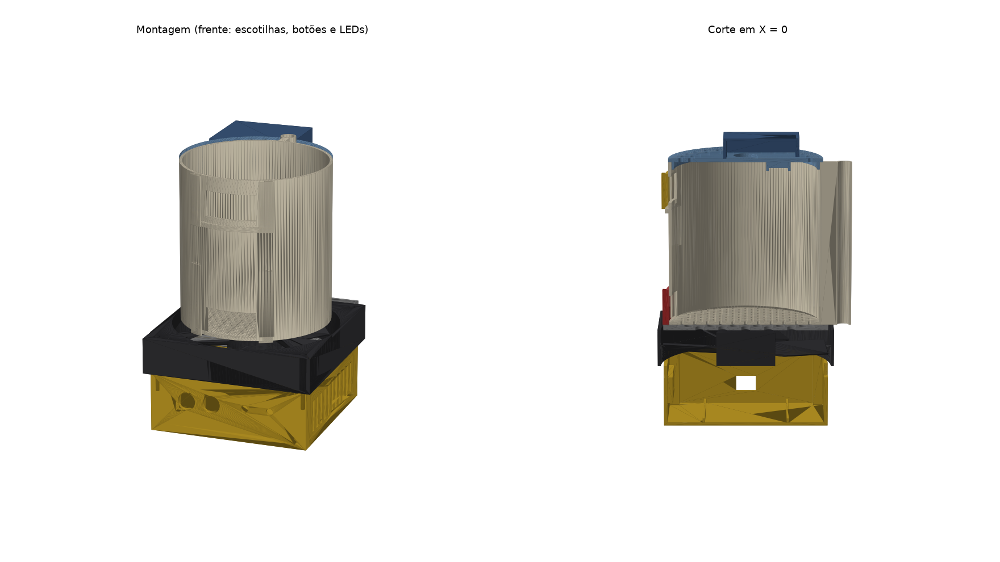

# Silo em 3D

Peças do silo de grãos para impressora com volume de **120 × 120 × 120 mm**. As medidas das peças eletrônicas
estão em [`docs/arquitetura.md`](../../docs/arquitetura.md) §3; as do silo, no início de `gerar_stl.py`.



## Peças

Os STLs em `stl/` já estão na orientação de impressão: é só abrir no fatiador, sem girar. Unidade: milímetro. Cada
peça está centralizada na origem e apoiada no solo (Z mínimo = 0). As malhas foram reparadas (vértices soldados,
triângulos degenerados removidos) e são fechadas, sem arestas abertas. Esta é a versão enviada ao professor em 2026-10-29.

`step/` tem o mesmo sólido de cada peça em STEP (convertido no FreeCAD 1.1.4), para abrir e editar no Fusion 360 ou
em outro CAD.

| Arquivo | Qtd | Medida (mm) | Observação de impressão |
|---|---|---|---|
| `0_peca_teste.stl` | 1 | 102 × 32 × 6 | **Imprimir primeiro** (~15 min) e testar os encaixes (abaixo) |
| `1_base.stl` | 1 | 112 × 112 × 42 | Caixa da eletrônica. Aberta em cima, sem suporte. Rasgos de ar nas paredes da direita e de trás |
| `2_tampa_base.stl` | 1 | 112 × 112 × 8 | Abas para cima. Rebaixo de 2 mm (câmara de ar) com furos Ø6 |
| `3_corpo.stl` | 1 | 107 × 107 × 112 | Piso na mesa, **na diagonal** (já sai girado 45°: o conduíte só cabe assim). Sem suporte: as aberturas das escotilhas são pontes de 36 mm. Piso de aeração com furos Ø2 |
| `4_tampa_silo.stl` | 1 | 104 × 104 × 8 | Topo na mesa, encaixe e bolso do DHT11 para cima. Respiros Ø3 na borda |
| `5_capa_sensor.stl` | 1 | 57 × 52 × 17 | Topo na mesa, pinos para cima. Rasgo dos fios atrás, virado para o conduíte |
| `6_escotilha_x2.stl` | 1 (são **2 escotilhas** no arquivo, 10 mm entre elas) | 47 × 29 × 24 | Em pé, como sai do arquivo. Usar brim: a peça é fina |

Cada arquivo é impresso 1 vez (7 impressões no total).

**Fatiador:** PLA, camada 0,2 mm, 3 perímetros, 15–20% de preenchimento, **sem suporte**. A base e a tampa da base
ocupam 112 mm da mesa de 120: **desligar saia (skirt) e brim** nessas duas, senão não cabem.

### Tampas em 2D (DXF)

`dxf/` tem as duas tampas em 2D: `2_tampa_base.dxf` e `4_tampa_silo.dxf`. São vistas de cima, com a peça na
posição de uso (frente = −Y, conduíte = +Y), centralizada na origem. Unidade: mm. Formato DXF R12, que abre no
LaserCAD/RDWorks, no LightBurn, no Inkscape e em qualquer CAD. Os furos são círculos de verdade, não polígonos.

| Camada | Cor | Conteúdo |
|---|---|---|
| `CORTE` | vermelho | Contorno externo e furos passantes. É o que a laser corta |
| `REBAIXO` | azul | Rebaixo de 2 mm da câmara de ar, na face de cima da tampa da base (dá para gravar) |
| `REFERENCIA` | verde | Partes que saem da chapa: abas da tampa da base, anel de encaixe e bolso do DHT11 da tampa do silo. Só para conferência: a laser não faz |

Chapa: 4 mm na tampa da base e 2,4 mm na tampa do silo. Cortadas em chapa plana, as tampas ficam sem as partes da
camada `REFERENCIA`. Para gerar de novo (usa os mesmos parâmetros de `gerar_stl.py`): `python gerar_dxf.py`.

## Ventoinha (aeração do silo)

Ventoinha de PC **120 × 120 × 25 mm** **entre a base e a tampa da base**, soprando **para cima**: a seta do fluxo, na
lateral da ventoinha, aponta para a tampa da base. Ela não cabe em nenhuma peça impressa, porque a mesa tem 120 mm.
Por isso fica como uma camada da torre, passando 4 mm da base de cada lado. Quem prende tudo são **4 parafusos M3 × 40**,
colocados por cima: cada um atravessa a tampa da base e o furo de canto da ventoinha (105 mm entre centros) e abre
rosca no furo-guia Ø2,6 da coluna da base, com ~11 mm de rosca.

Caminho do ar: rasgos das paredes da direita e de trás da base → eletrônica → ventoinha → furos Ø6 da tampa da base
→ câmara de 2 mm embaixo do silo → piso furado Ø2 → grão → respiros da tampa do silo.

- **Fios:** o conduíte fica atrás, afastado do silo, para os fios dos sensores descerem por fora da ventoinha. Eles
  entram na base pela passagem no topo da parede de trás, logo abaixo da ventoinha. O cabo da ventoinha entra pela
  mesma passagem.
- **Grão:** os furos de Ø2 do piso seguram soja, milho e feijão. Para grão miúdo (arroz), forrar o piso com tela ou TNT.
- **Pendente:** como acionar a ventoinha. Ventoinha de 12 V precisa de fonte de 12 V e de um transistor ou MOSFET
  no GPIO 23 (no lugar do LED de ventilação ou junto com ele). Isso entra em `docs/decisoes-pendentes.md` antes de
  ligar.

## Peça de teste

Antes das peças grandes, conferir com os componentes reais:

| Furo | Esperado | Se não servir |
|---|---|---|
| 2 × Ø16,5 (centros a 26) | Transdutores do HC-SR04 entram juntos, sem forçar | Ajustar `HC_FURO_D` / `HC_CENTROS` |
| Furo Ø12,5 + bolso quadrado | Capa do botão passa pelo furo; o corpo 12 × 12 assenta no bolso | Ajustar `BOTAO_FURO_D` / `BOTAO_BOLSO` |
| LED Ø5,2 e Ø5,5 | No de 5,2 o LED entra justo e a aba segura | Se não entrar, usar 5,5 em `LED_FURO_D` e colar |
| Bolso retangular | DHT11 encaixa | Ajustar `DHT_BOLSO` |

Depois de mudar um valor, gerar os STLs de novo (abaixo).

## Montagem

```
        capa do sensor   ← HC-SR04 por baixo dela, transdutores atravessando a tampa
        tampa do silo    ← DHT11 no bolso de baixo, virado para dentro do silo
   ┌──  corpo do silo    ← escotilha de entrada (em cima) e de saída (embaixo), na frente
   │    conduíte         ← tubo atrás: fios do HC-SR04 e do DHT11 descem por ele, por fora da ventoinha
        tampa da base    ← abas centralizam o corpo; câmara de ar e furos em cima da ventoinha
        ventoinha 120 mm ← sopra para cima; presa com a tampa da base por 4 parafusos nas colunas da base
        base             ← protoboard + ESP32; botões e LEDs no painel da frente; USB na lateral esquerda
```

1. **Base:** encaixar a protoboard de 400 pontos nas guias, encostada na parede do USB, com o ESP32 na ponta desse
   lado. Conferir se o cabo micro-USB entra pela abertura.
2. **Painel da frente**, da esquerda para a direita: botão **amarelo (entrada)**, botão **vermelho (saída)**, LED de
   **alerta** e LED de **ventilação**. Botões por dentro, com o corpo no bolso quadrado; LEDs por dentro, com a aba
   encostada na parede. Firmar com cola quente.
3. **Ventoinha e tampa da base:** apoiar a ventoinha em cima da base, com o fluxo para cima e o cabo do lado de trás,
   e a tampa da base em cima dela. Passar os 4 parafusos M3 × 40 por cima e apertar até firmar, sem forçar (a parede
   da coluna é fina). O cabo da ventoinha entra pela passagem do topo da parede de trás. Para apertar o BOOT na
   gravação, tirar o corpo, os parafusos, a tampa da base e a ventoinha.
4. **Corpo:** apoiar na tampa da base, dentro das 3 abas, com o conduíte para trás.
5. **Escotilhas:** cada porta entra nos trilhos por cima. A de entrada descansa no degrau; a de saída, na tampa da base.
   Para abrir, levantar pelo puxador.
6. **Tampa do silo:** DHT11 no bolso de baixo (cola quente), com o cabo saindo pelo rasgo e subindo pelo furo.
   HC-SR04 por cima, transdutores nos dois furos, pinos virados para o lado do furo do DHT11.
7. **Capa:** por cima do HC-SR04, pinos nos 4 furos da tampa. Os 7 fios saem pelo rasgo de trás da capa, descem pelo conduíte
   e entram na base pela passagem do topo da parede de trás.

O grão cheio deve ficar abaixo da escotilha de entrada (~3 cm abaixo dos transdutores): é a zona morta do HC-SR04.

## Gerar os STLs

```sh
pip install -r requirements.txt
python gerar_stl.py
```

O script mostra a medida de cada peça, se ela é um sólido fechado e se cabe na mesa.

**Atenção:** o script gera a malha bruta, com a escotilha avulsa (`6_escotilha.stl`) e sem centralizar as peças nem
fazer o reparo descrito acima. Ele sobrescreve os arquivos de `stl/`. Depois de mudar uma medida, é preciso reparar e
centralizar de novo e regerar os STEP de `step/`.
